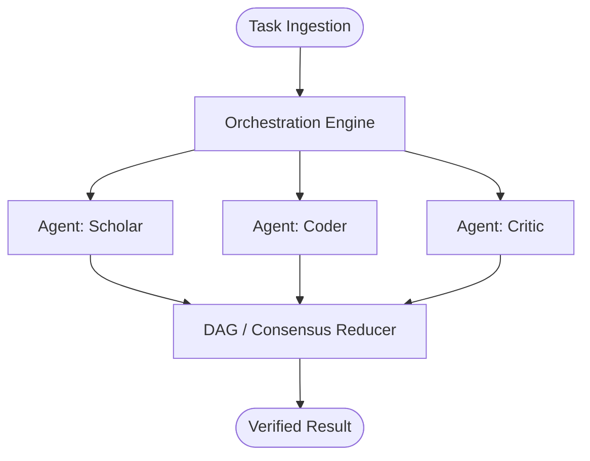

# Orchestration Engine

[](https://www.python.org/downloads/)
[](https://opensource.org/licenses/MIT)
[](https://github.com/pokushko/orchestration-engine)
[](https://github.com/pokushko/awesome-autonomous-agent-resilience)

A lightweight, zero-dependency Python `asyncio` orchestration engine for Multi-Agent Systems (MAS). Supports concurrent scatter-gather broadcast, fault-isolated agent execution with timeouts and retries, topologically validated DAG pipelines, and consensus reducers. Part of the [EvoNova Labs](https://github.com/pokushko) open-source resilience stack.



---

## Key Features

- **Broadcast with Fault Isolation:** Concurrent task dispatch via `asyncio.gather` returning structured `AgentResult` records so one failing agent never crashes the fleet.
- **DAG Workflow Execution (`run_dag`):** Kahn's topological sort validates dependency graphs upfront (catching cycles and missing references before execution), runs independent waves concurrently, and passes upstream outputs into downstream tasks.
- **Timeouts & Exponential Backoff Retries:** Configurable `timeout_s`, `max_retries`, and `retry_delay_s` per `LiteAgent`.
- **Consensus Reducers:** Built-in majority vote or custom sync/async reducer callbacks across agent outputs.
- **Zero External Runtime Dependencies:** Uses Python 3.10+ standard library only.

---

## Quickstart

### Installation

```bash
git clone https://github.com/pokushko/orchestration-engine.git
cd orchestration-engine
pip install -e .
```

### Usage Examples

```python
import asyncio
from orchestrator import LiteAgent, Orchestrator


async def run_workflows() -> None:
    engine = Orchestrator()
    engine.register(LiteAgent("Scholar", "Literature Search", handler=lambda t: f"papers:{t}"))
    engine.register(LiteAgent("Coder", "Implementation", handler=lambda t: f"code:{t}"))
    engine.register(LiteAgent("Critic", "Verifier", handler=lambda t: f"audit({t})"))

    # 1. Parallel broadcast
    broadcast_outputs = await engine.broadcast("agent resilience")
    print("Broadcast:", broadcast_outputs)

    # 2. DAG pipeline (Scholar and Coder run concurrently, Critic consumes both)
    dag_results = await engine.run_dag(
        {
            "research": {"agent": "Scholar", "task": "memory bounds"},
            "implement": {"agent": "Coder", "task": "wal_journal"},
            "verify": {
                "agent": "Critic",
                "task": "{research} | {implement}",
                "depends_on": ["research", "implement"],
            },
        }
    )
    print("DAG final:", dag_results["verify"].output)

    # 3. Majority consensus
    verdict = await engine.consensus("approve release")
    print("Consensus:", verdict["winner"])


if __name__ == "__main__":
    asyncio.run(run_workflows())
```

---

## Running Tests

```bash
pip install pytest
pytest -v
```

---

## 🌐 EvoNova Labs Open-Source Ecosystem

Part of the **[EvoNova Labs](https://pokushko.github.io)** open-source AI resilience & scientific integrity stack by **[Roman Pokushko](https://github.com/pokushko)** ([pokusko.roman@gmail.com](mailto:pokusko.roman@gmail.com)):

| Project | Role in Stack | Link |
| :--- | :--- | :--- |
| **Awesome Agent Resilience** | Curated index (`160` entries), MAST/OWASP Failure Taxonomy & `F01–F10` chaos benchmark | [pokushko/awesome-autonomous-agent-resilience](https://github.com/pokushko/awesome-autonomous-agent-resilience) |
| **AgentBunker** | 24/7 WAL intent journal, RSS memory ceiling watchdog & tri-state circuit breakers | [pokushko/agent-bunker](https://github.com/pokushko/agent-bunker) |
| **Orchestration Engine** | Zero-dependency `asyncio` MAS router, Kahn DAG waves & consensus reducers | [pokushko/orchestration-engine](https://github.com/pokushko/orchestration-engine) |
| **Agent Security Sandbox** | Pre-flight Python AST guard against dunder escapes & prompt-injection sanitizer | [pokushko/agent-security-sandbox](https://github.com/pokushko/agent-security-sandbox) |
| **Agentic Vector Memory** | Dual-store episodic & semantic memory with exponential decay & SQLite persistence | [pokushko/agentic-vector-memory](https://github.com/pokushko/agentic-vector-memory) |
| **EvoNova Causal Guard** | Pearl *do*-calculus DAG verifier, Tabu memory & multi-agent debate arbiter | [pokushko/evonova-causal-guard](https://github.com/pokushko/evonova-causal-guard) |
| **Sci Integrity Guard** | Cross-table numeric parity linter, CrossRef/OpenAlex DOI checker & LaTeX-to-OMML | [pokushko/sci-integrity-guard](https://github.com/pokushko/sci-integrity-guard) |
| **KTK ELOU-AVT Core** | Industrial cybernetic digital twin prototype for crude oil ELOU-AVT units | [pokushko/ktk_elou_avt_core](https://github.com/pokushko/ktk_elou_avt_core) |
| **EvoNova Chem Core** | RDKit molecular descriptor screening core for physical constraint enforcement | [pokushko/evonova-chem-core](https://github.com/pokushko/evonova-chem-core) |

## License

MIT License. See [LICENSE](LICENSE).
