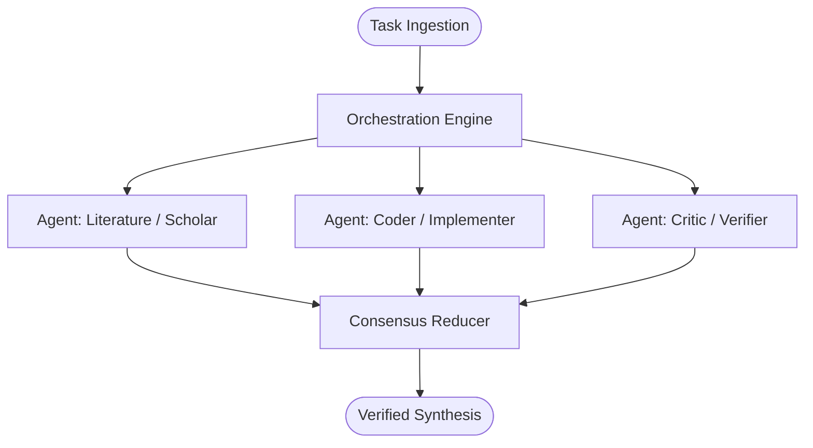

# Orchestration Engine 🤖

[](https://www.python.org/downloads/)
[](https://opensource.org/licenses/MIT)
[](https://github.com/pokushko/orchestration-engine)

A lightweight, high-performance orchestration engine for Multi-Agent Systems (MAS). Designed for asynchronous message-passing, parallel task routing, and cooperative consensus across autonomous AI agents.



---

## Key Features

- **Asynchronous Execution:** Non-blocking agent dispatching powered by Python `asyncio`.
- **Role-Based Task Routing:** Decoupled agent roles with isolated execution environments.
- **Broadcast & Pipeline Patterns:** Support for concurrent multi-agent scatter-gather and sequential pipelining.
- **Zero Overhead:** Minimal dependencies, high throughput, and seamless integration with existing agent toolkits.

---

## Quickstart

### Installation

```bash
git clone https://github.com/pokushko/orchestration-engine.git
cd orchestration-engine
pip install -r requirements.txt
```

### Usage Example

```python
import asyncio
from orchestrator import Orchestrator, LiteAgent

async def run_pipeline():
    engine = Orchestrator()
    engine.register(LiteAgent("Scholar", "Literature Search"))
    engine.register(LiteAgent("Coder", "Implementation"))
    engine.register(LiteAgent("Critic", "Verification & Audit"))

    results = await engine.broadcast("Optimize multi-agent state persistence")
    for res in results:
        print(res)

if __name__ == "__main__":
    asyncio.run(run_pipeline())
```

---

## Author & Architecture

**Roman Pokushko**  
Autonomous Multi-Agent Systems Architect & Quantitative Systems Researcher  
GitHub: [@pokushko](https://github.com/pokushko)  
Project Ecosystem: [Agent Security Sandbox](https://github.com/pokushko/agent-security-sandbox) | [Agentic Vector Memory](https://github.com/pokushko/agentic-vector-memory)

---

## License

MIT License. Free for open-source research and commercial application.
